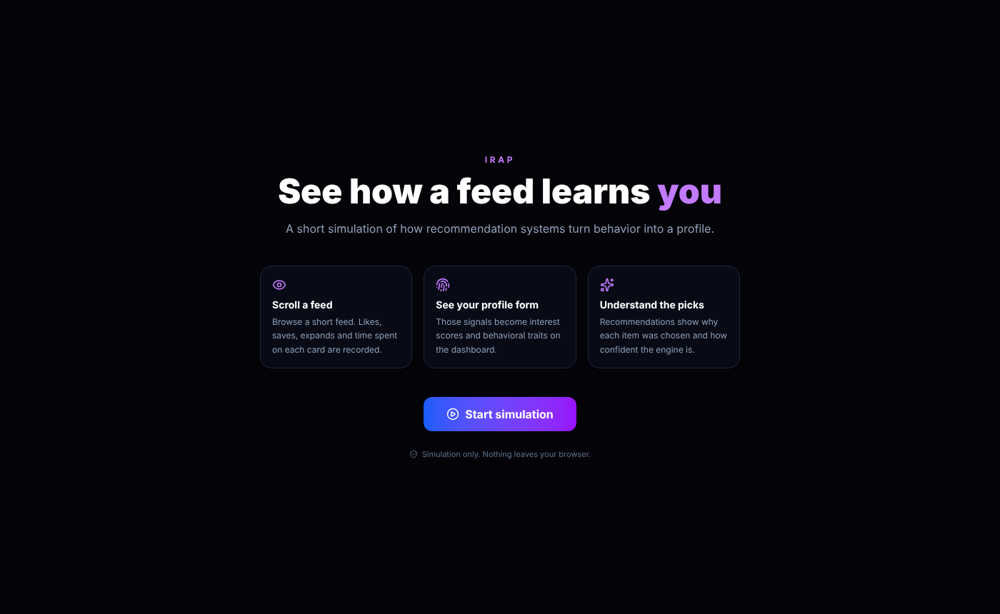
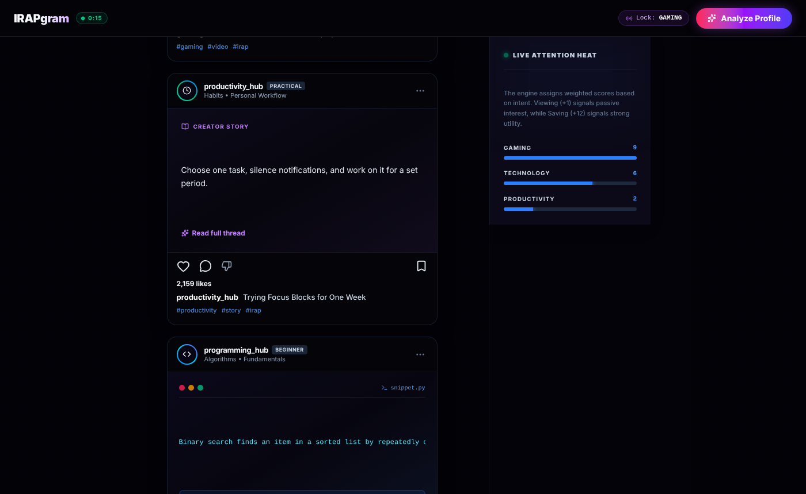
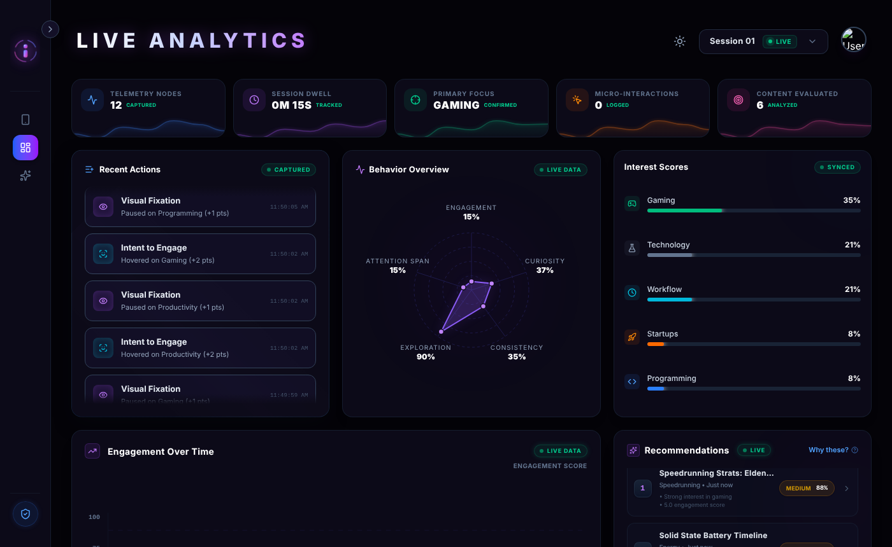
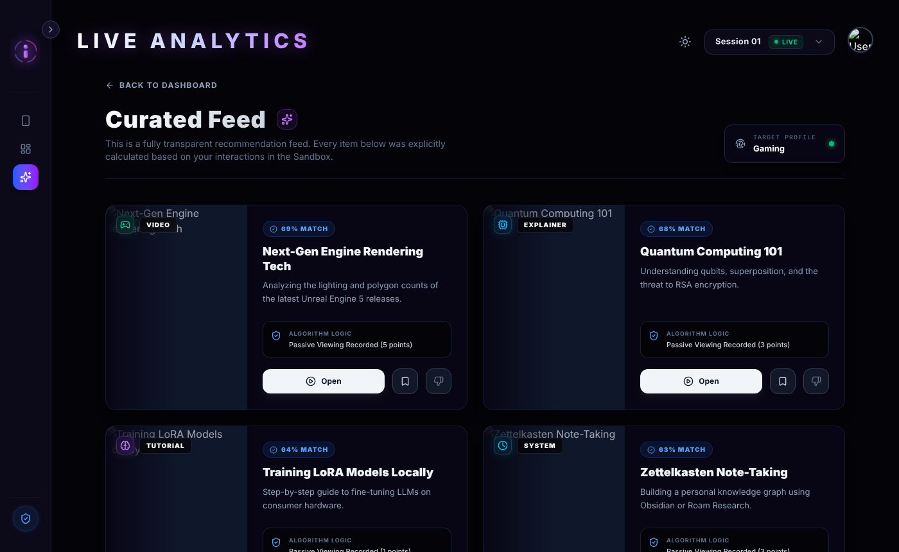

# IRAP — Intelligent Recommendation & Attention Profiling

A small, browser-only simulation of how a feed turns behavior into a profile, and how recommendations can be explained instead of treated as a black box.

**The loop:** scroll a feed → telemetry is captured → an interest profile is built → recommendations show *why* they were picked.

Everything is simulated in the browser. No real user data is collected or sent anywhere.

## Screenshots

| Welcome | Content Sandbox |
|---|---|
|  |  |

| Dashboard | Recommendations |
|---|---|
|  |  |

## Screens

| Screen | What it does |
|---|---|
| **Content Sandbox** | A short feed of 32 cards across 8 categories. Likes, saves, expands and dwell time are recorded. |
| **Dashboard** | Live stats, behavior radar, interest scores, engagement trend, recommendation preview. |
| **Recommendations** | Curated feed where every item shows its match score and the signal that triggered it. |

## Run it

```bash
cd client
npm install
npm run dev
```

Build for production with `npm run build`.

## Deploy

It is a static site, so any static host works.

- **Vercel:** import the repo, set **Root Directory** to `client`. Build settings are picked up from `client/vercel.json`.
- **Netlify:** import the repo. `netlify.toml` already sets the base folder, build command and publish folder.

After deploying, add the live link at the top of this README.

## Stack

React 19, Vite, Tailwind CSS, Recharts, Framer Motion, Lucide icons.

## Structure

```
client/src/
├── App.jsx                     screen switching
├── hooks/TelemetryContext.jsx  all telemetry state and scoring
└── components/
    ├── sandbox/                feed, content data, session engine
    ├── pages/                  DashboardView, RecommendationsView
    ├── dashboard/              cards and charts
    └── shared/                 sidebar, topbar, footer
```

## Possible next steps

- Persist sessions (localStorage first, a backend later)
- Replace rule-based scoring with a simple learned model
- Tests for the scoring logic in `TelemetryContext.jsx`

## Author

Muhammed Adil M N
